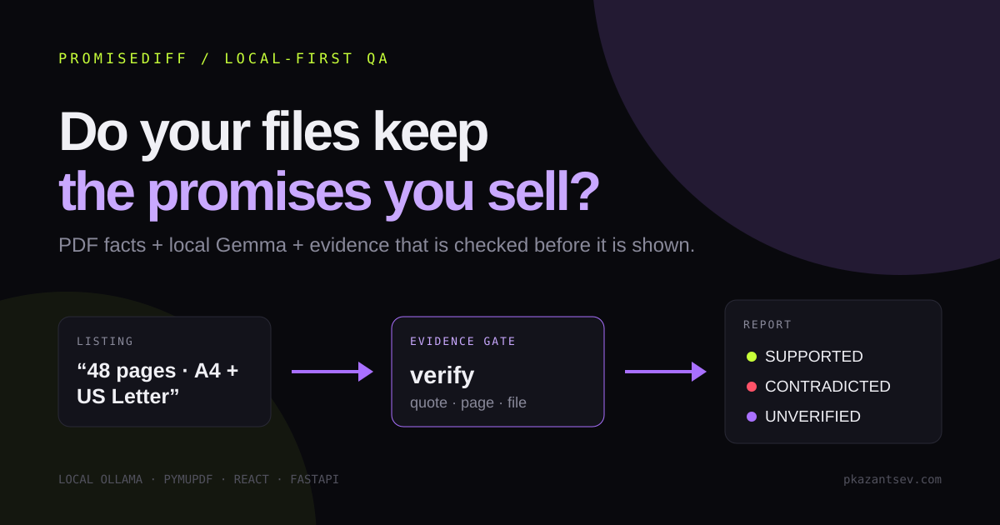
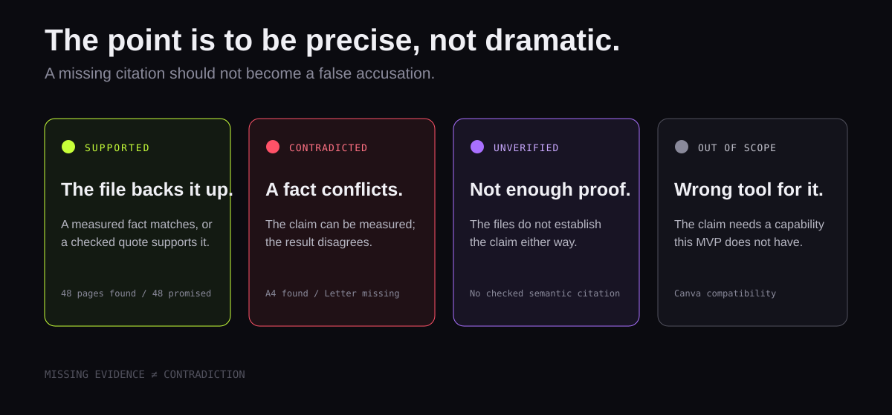
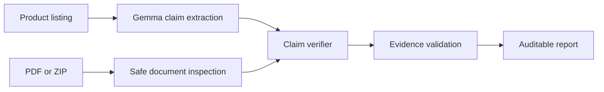
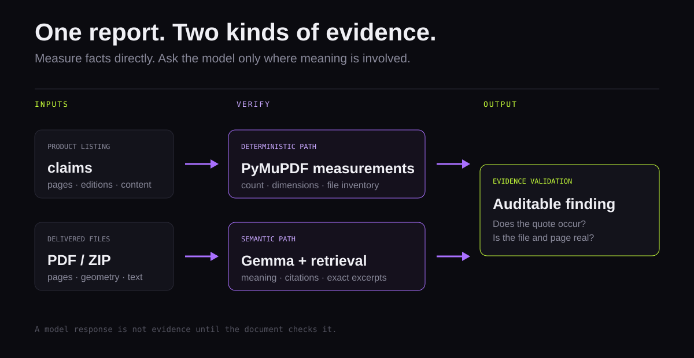
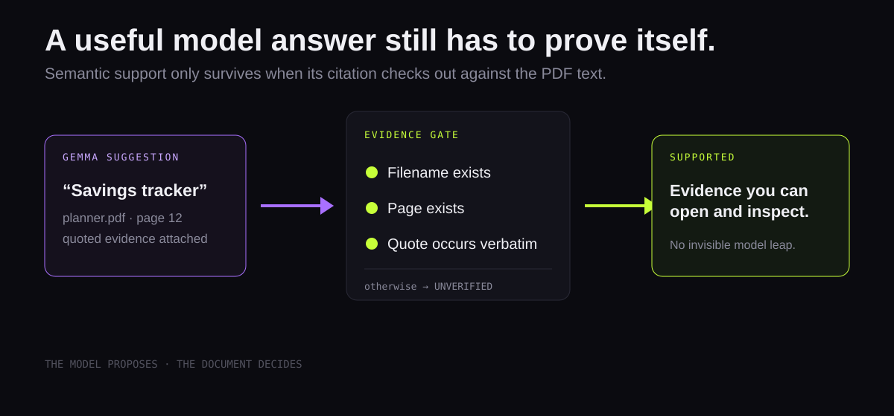
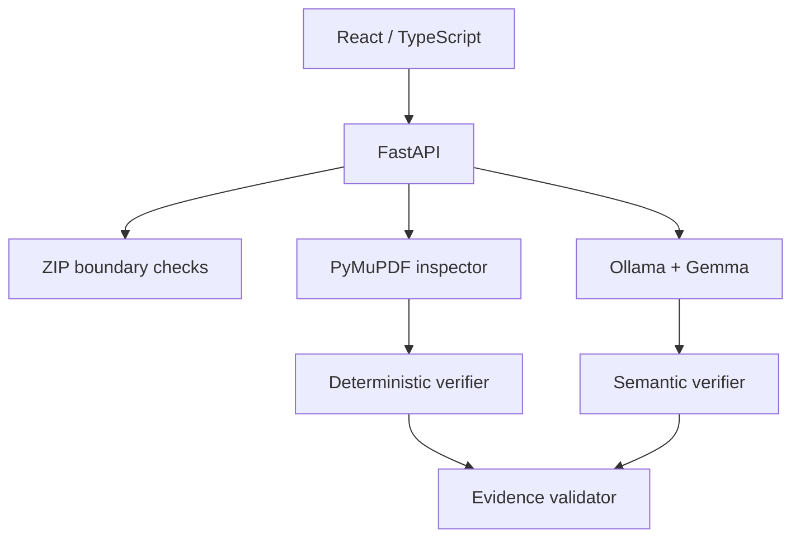
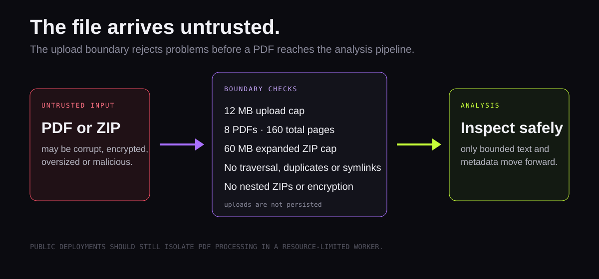
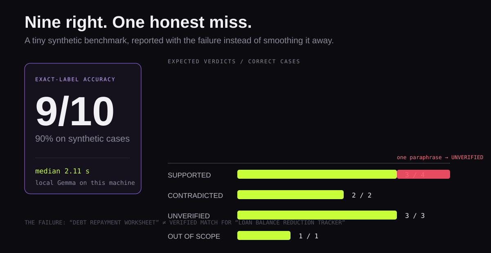
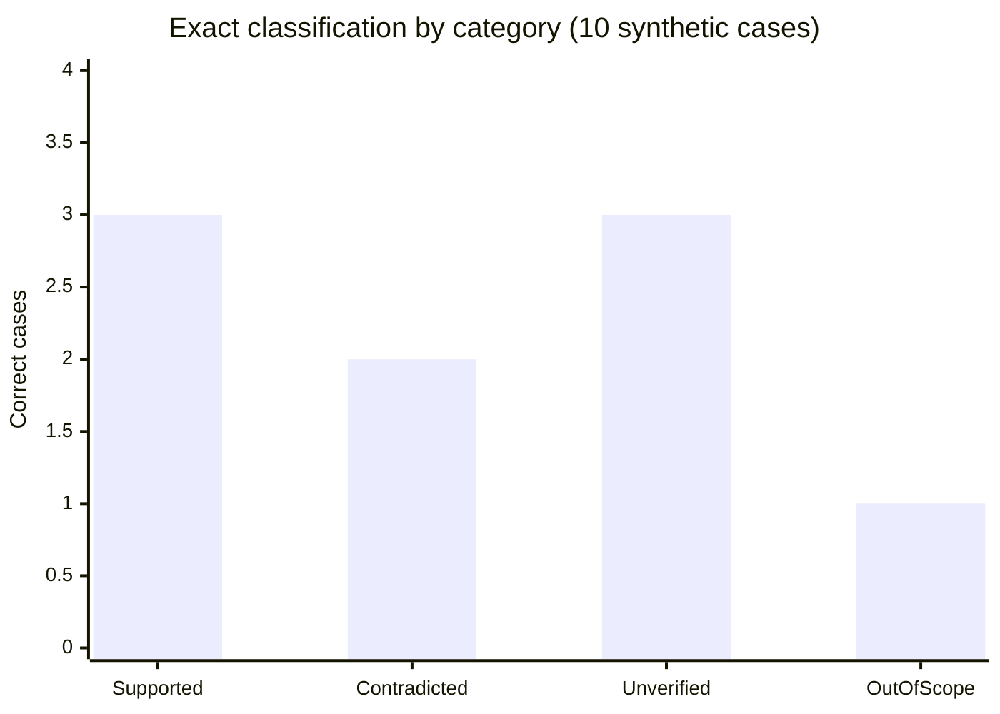

*This is a submission for the [Hacktoberfest Open-Source AI Challenge Week 2: Side Hustle](https://dev.to/challenges/hacktoberfest-week2-2026-10-12).*

# I Built an AI That Checks Whether Digital Products Deliver What They Promise

A digital-product listing can promise “48 pages”, “A4 and US Letter editions”, and “debt repayment worksheets.” Then the customer opens the ZIP and finds something else.

For a small seller, that turns into refunds, support messages, rough reviews, and the awful feeling that you missed something obvious. PromiseDiff is a local-first pre-publish check for Etsy, Gumroad, template, and educational-PDF sellers.

Paste in the listing. Upload the actual PDF or ZIP. PromiseDiff shows what the files can back up, what they contradict, and what they simply cannot prove.

**The rule I cared about most:** missing text is not a failure. A measured mismatch is a contradiction; a claim the files cannot prove is just unverified.



## What I built

Every claim gets one of four plain outcomes:

| Result | Meaning |
|---|---|
| `SUPPORTED` | The supplied evidence supports this exact promise. |
| `CONTRADICTED` | A reproducible check established a conflicting fact. |
| `UNVERIFIED` | The files do not establish the claim. Missing evidence is not a contradiction. |
| `OUT_OF_SCOPE` | The claim needs a capability the MVP cannot test. |

The point is not a dramatic yes-or-no verdict. Every result keeps the method and the evidence that led to it.





For example, a page-count claim is deterministic:

```text
Listing: “The main PDF contains exactly 48 pages.”
File:    budget_planner_A4.pdf → 48 pages
Result:  SUPPORTED — DETERMINISTIC
```

“Includes debt repayment worksheets” is different. A PDF might call that page a “Loan Balance Reduction Tracker.” Here Gemma looks at the extracted text, but PromiseDiff only accepts the result after checking the suggested filename, page, and quote against the actual PDF.



## Demo

The demo uses a real 48-page A4 Budget Planner PDF. Nothing is mocked.

I recorded the product walkthrough with [ProgressCut](https://github.com/icesurf666/progress-cut), my local-first tool for turning a longer screen recording into a short visual story. It is a useful pairing: PromiseDiff checks the release before it ships; ProgressCut helps explain the release after it is ready.

The listing promises:

```text
The main PDF contains exactly 48 pages.
Includes both A4 and US Letter PDF editions.
Contains monthly budget review worksheets.
Includes savings goal trackers.
```

The upload only has the A4 edition. PromiseDiff confirms the page count, flags the missing US Letter version, and lets the seller open the evidence or export the report as Markdown.


<!-- Before publishing on DEV: upload this GIF and replace the local asset link with DEV's image URL. -->

## Why a hybrid system instead of “ask the model”? 

Some questions have a simple answer; others need interpretation.

| Question | Correct tool |
|---|---|
| How many PDF pages exist? | PyMuPDF metadata |
| Is this page actually A4? | PDF geometry with a 3-point tolerance |
| Does a listed file exist? | Complete file inventory |
| Does “Loan Balance Reduction Tracker” plausibly satisfy a debt-repayment claim? | Gemma plus validated quotation |

Asking a language model to count pages is slower and worse than reading the PDF metadata. But keyword search alone will not reliably connect “debt repayment” and “loan balance reduction.” So each tool only gets the jobs it can actually support with evidence.

The rule underneath it all is:

```text
missing evidence != contradiction
```



If the document is scanned, the claim scope is ambiguous, a citation points to a nonexistent page, or a quote does not occur in extracted text, the answer is `UNVERIFIED`.

## How I built it

It is a small React + FastAPI app, with no need for a complicated distributed setup:



Uploads are untrusted, so the backend puts tight boundaries around them: size, PDF count, total pages, extracted text, ZIP ratio, file types, and expanded ZIP size. It rejects traversal paths, duplicate entries, encrypted PDFs, nested archives, and corrupt files. The original upload is never saved.



The model work is deliberately kept small:

1. Gemma extracts structured promises from the listing.
2. Python validates source quotations and normalizes measurable claims.
3. Local retrieval selects compact, potentially relevant PDF excerpts.
4. Gemma evaluates semantic correspondence in batch.
5. Evidence validation checks filename, page, and exact quote before serialization.

## Why open innovation matters

This matters because many sellers are working on unpublished material: course notes, templates, client downloads, and draft listings. With the local setup, Ollama keeps the listing text and extracted PDF text on the seller’s machine.

Open-weight Gemma also makes this affordable for a small operation. A local run has no per-audit third-party API bill, although someone still pays for the hardware or hosting. Sellers can repeat the same check before every release without handing their draft material to another service.

## Reproducible benchmark, including a failure

I made ten independently labelled synthetic PDF cases and ran them through the same local API the UI uses. The runner saves the raw responses and timings in `benchmark/results.json`.

```text
exact-label accuracy = correct labels / total cases = 9 / 10 = 90%
```





| Metric | Result | Caveat |
|---|---:|---|
| Exact-label accuracy | 90% (9/10) | Tiny synthetic evaluation, not a generalization claim. |
| Contradiction precision | 100% (2/2) | Both measured failures were page/dimension facts. |
| Contradiction recall | 100% (2/2) | Same small set. |
| Supported recall | 75% (3/4) | One semantic paraphrase was conservatively left unverified. |
| Median API latency | 2.11 s | Local Gemma on this machine. |
| Mean API latency | 3.50 s | Prompt-injection case took 13.81 s. |

The miss is the useful bit. The listing said **debt repayment worksheet** and the PDF said **Loan Balance Reduction Tracker**. The model did not have strong enough evidence to connect them, so PromiseDiff returned `UNVERIFIED` instead of pretending it knew. That is a limitation to fix, not a result to hide.

## Known limitations

- The benchmark is small and synthetic. It is not a claim about every kind of seller PDF.
- Scanned documents without extractable text can still receive metadata checks, but semantic claims remain unverified.
- The current retrieval can miss paraphrases. In the benchmark, “debt repayment worksheet” and “Loan Balance Reduction Tracker” stayed unverified rather than becoming a false positive.
- Public deployments should isolate PDF processing with strict resource limits.

## What I would build next

- Better paraphrase retrieval before semantic evaluation.
- Seller feedback on which promise types produce the most costly mistakes.
- Batch release audits and version-to-version diffs.
- Isolated PDF processing for public deployments.

## Code

<!-- Before publishing: replace the URL below with the public GitHub repository. -->

[PromiseDiff source code](https://github.com/REPLACE_WITH_OWNER/PromiseDiff)

The repository has the local setup, real example PDF, test commands, security notes, and benchmark runner.

## Prize categories

- Best Use of Gemma

<!-- Optional: add a real user story here only after receiving permission. Do not fabricate one. -->
