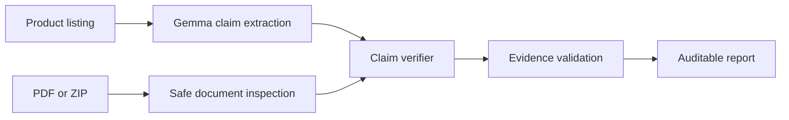
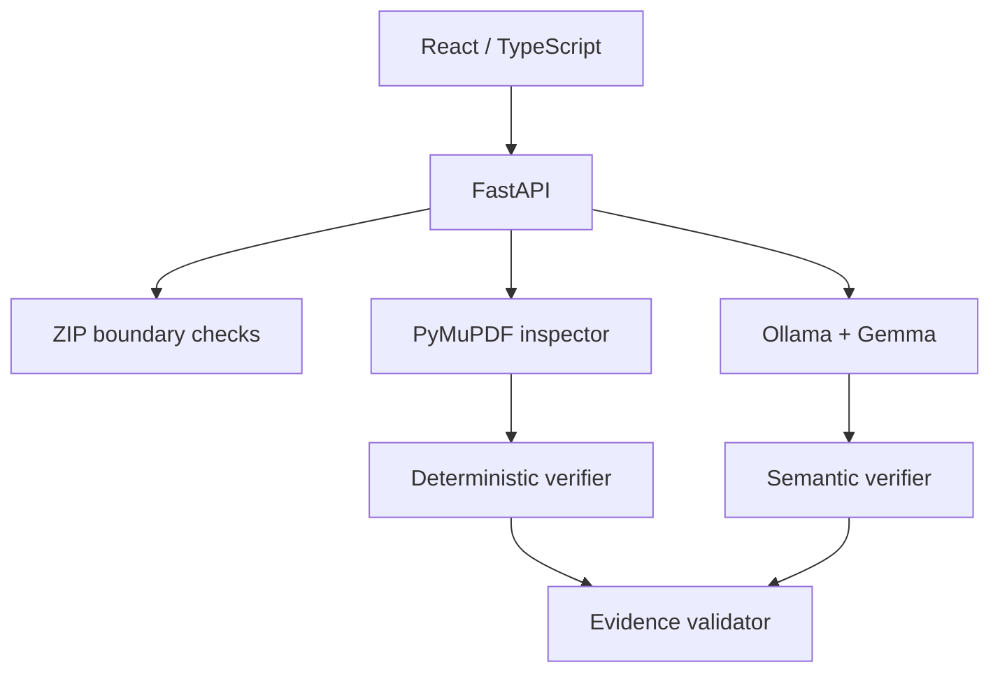
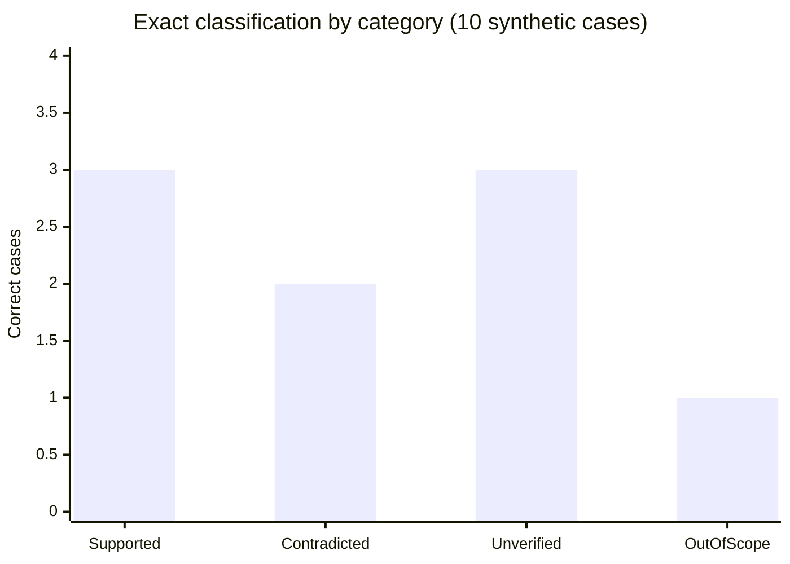

*This is a submission for the [Hacktoberfest Open-Source AI Challenge Week 2: Side Hustle](https://dev.to/challenges/hacktoberfest-week2-2026-10-12).*

# I Built an AI That Checks Whether Digital Products Deliver What They Promise

A digital-product listing can say “48 pages”, “A4 and US Letter editions”, and “debt repayment worksheets.” The ZIP a customer downloads can tell a very different story.

That mismatch is expensive in a very small-business way: refund requests, one-star reviews, support messages, and a seller losing confidence in their own release process. PromiseDiff is a local-first pre-publish QA tool for Etsy, Gumroad, template, and educational-PDF sellers.

Paste a listing. Upload the actual PDF or ZIP. Get an evidence-backed diff between the promise and the deliverable.

## What I built

PromiseDiff separates statements into four honest outcomes:

| Result | Meaning |
|---|---|
| `SUPPORTED` | The supplied evidence supports this exact promise. |
| `CONTRADICTED` | A reproducible check established a conflicting fact. |
| `UNVERIFIED` | The files do not establish the claim. Missing evidence is not a contradiction. |
| `OUT_OF_SCOPE` | The claim needs a capability the MVP cannot test. |

The important part is not that it produces a verdict. The important part is that every verdict retains its method and evidence.



For example, a page-count claim is deterministic:

```text
Listing: “The main PDF contains exactly 48 pages.”
File:    budget_planner_A4.pdf → 48 pages
Result:  SUPPORTED — DETERMINISTIC
```

But “includes debt repayment worksheets” is semantic. A document might call it a “Loan Balance Reduction Tracker.” PromiseDiff asks Gemma to interpret actual extracted text, then accepts support only when the proposed filename, page, and quotation are validated against the PDF.

## Demo

The included demo is a real 48-page A4 Budget Planner PDF—not a mocked response.

The listing promises:

```text
The main PDF contains exactly 48 pages.
Includes both A4 and US Letter PDF editions.
Contains monthly budget review worksheets.
Includes savings goal trackers.
```

The delivered file contains only the A4 edition. PromiseDiff detects the page count as supported and the missing US Letter edition as contradicted. The UI lets a seller expand evidence and export the verified report as Markdown.

> Add a 30–60 second screen recording here: click **Try Example**, click **Verify Product**, expand a finding, then export the report.

## Why a hybrid system instead of “ask the model”? 

The system has two kinds of truth.

| Question | Correct tool |
|---|---|
| How many PDF pages exist? | PyMuPDF metadata |
| Is this page actually A4? | PDF geometry with a 3-point tolerance |
| Does a listed file exist? | Complete file inventory |
| Does “Loan Balance Reduction Tracker” plausibly satisfy a debt-repayment claim? | Gemma plus validated quotation |

Letting a language model count PDF pages is both slower and less reliable than reading the document. On the other hand, plain keyword search cannot reliably connect “debt repayment” to “loan balance reduction.” The design deliberately uses each tool only where it has evidence.

The core safety invariant is:

\[
\text{missing evidence} \not\Rightarrow \text{contradiction}
\]

If the document is scanned, the claim scope is ambiguous, a citation points to a nonexistent page, or a quote does not occur in extracted text, the answer is `UNVERIFIED`.

## How I built it

The application is a compact React + FastAPI modular monolith:



Security boundaries matter because an upload is untrusted. The backend limits upload bytes, PDF count, total pages, extracted text, ZIP decompression ratio, archive member type, and cumulative uncompressed bytes. It rejects traversal paths, duplicate archive entries, encrypted PDFs, nested archives, and corrupt inputs. Original uploads are never persisted.

The model pipeline is intentionally bounded:

1. Gemma extracts structured promises from the listing.
2. Python validates source quotations and normalizes measurable claims.
3. Local retrieval selects compact, potentially relevant PDF excerpts.
4. Gemma evaluates semantic correspondence in batch.
5. Evidence validation checks filename, page, and exact quote before serialization.

## Why open innovation matters

PromiseDiff is useful precisely because sellers may be working with unpublished products: course materials, templates, client-facing downloads, and draft listings. Local Ollama inference means that product text and extracted PDF content stay on the seller’s machine by default.

Open-weight Gemma makes the side-hustle economics practical too. There is no per-audit commercial API bill and no hosted dependency required for the core workflow. A seller can run the same QA process repeatedly before every release, while retaining control of the model and data path.

## Reproducible benchmark, including a failure

I generated ten independently labelled synthetic PDF cases and ran them through the same local API used by the UI. The runner records raw responses and latency in `benchmark/results.json`.

\[
\text{Exact-label accuracy} = \frac{1}{N}\sum_{i=1}^{N}\mathbb{1}(\hat{y_i}=y_i)
= \frac{9}{10}=0.90
\]



| Metric | Result | Caveat |
|---|---:|---|
| Exact-label accuracy | 90% (9/10) | Tiny synthetic evaluation, not a generalization claim. |
| Contradiction precision | 100% (2/2) | Both measured failures were page/dimension facts. |
| Contradiction recall | 100% (2/2) | Same small set. |
| Supported recall | 75% (3/4) | One semantic paraphrase was conservatively left unverified. |
| Median API latency | 2.11 s | Local Gemma on this machine. |
| Mean API latency | 3.50 s | Prompt-injection case took 13.81 s. |

The failed case is the most useful result. The listing claimed a **debt repayment worksheet** and the PDF said **Loan Balance Reduction Tracker**. The model did not produce evidence strong enough to accept, so PromiseDiff returned `UNVERIFIED` instead of inventing support. This is a product limitation to improve, not a benchmark result to hide.

## What I would build next

- Better paraphrase retrieval before semantic evaluation.
- Seller feedback on which promise types produce the most costly mistakes.
- Batch release audits and version-to-version diffs.
- Isolated PDF processing for public deployments.

## Code

> Add the public GitHub repository URL here after publishing. The repository includes local setup, the real example PDF, test commands, security limitations, and the benchmark runner.

## Prize categories

- Best Use of Gemma

## My first user

I am looking for an Etsy/Gumroad seller to run one actual listing through PromiseDiff. I will publish their feedback only with permission and will not claim a paying customer before one exists.
